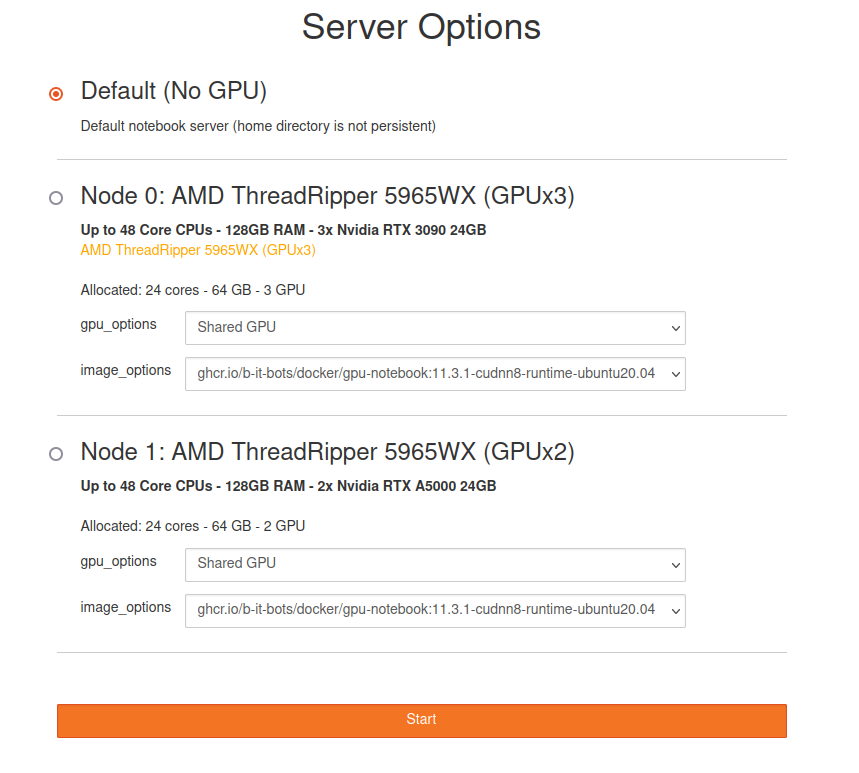
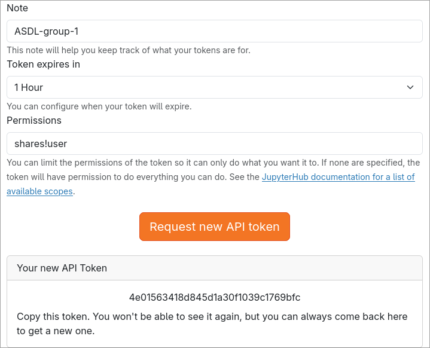
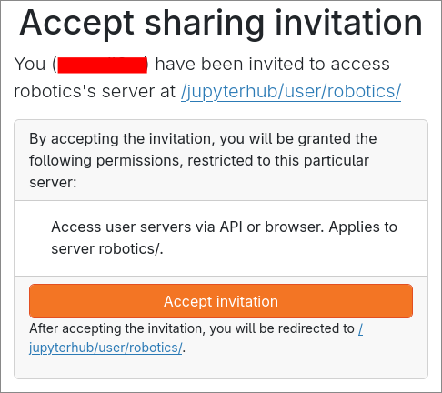
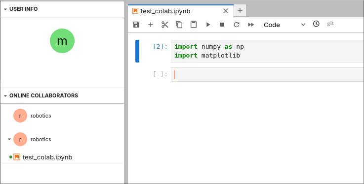

# JupyterHub
JupyterHub is an open-source tool that enables the deployment of multi-user Jupyter Notebook servers. 
With JupyterHub, multiple users can access and collaborate on a shared computing environment.
JupyterHub provides an easy-to-use web interface for managing user accounts, launching notebooks, and managing user environments. Moreover, JupyterHub is highly customizable, allowing administrators to set up authentication and authorization systems, customize user environments, and integrate with other tools and services.

## Login
Log in using FB02 GitLab


## Server options
Depending on the user's request, server options for each user can differ. 



:::note
**Default** does not have access to GPU and the storage is ephemeral (not persistent).
:::

:::info
Note that if you have access to shared GPUs, other users may have been using them already.
:::

## Directory structure
```
# Home directory
/home/jovyan

# Userdata directory with a bigger storage for datasets and logs
/home/jovyan/userdata/{username}
```

## Resource usage monitoring

* Monitor GPU usage using nvtop
  ```
  nvtop
  ```

## Sharing your Jupyter Server
You can share your running Jupyter Server with other cluster users, e.g. to work on a notebook together in real time or let a supervisor look at your results. When several people have the same notebook open, everyone sees the others' edits and outputs live.

:::warning
Anyone you share your server with has **full access** to it. They can read, change and delete your files (including `/home/jovyan/userdata/{username}`), open terminals, run code as you and use your GPUs. Only share with people you trust, and revoke access when you are done.
:::

### Generate a Shared Link
In JupyterLab, open the notebook you want to share and click **Generate a Shared Link** (top right). The dialog shows a link to the current notebook, e.g.

```
https://a2s-cluster.inf.h-brs.de:30443/jupyterhub/user/<your-username>/lab/tree/test_colab.ipynb
```

Click **Copy Link** and send it. Who can open the link depends on the **Include token in URL** checkbox:

| Include token in URL | Who can open the link |
| -------------------- | --------------------- |
| Unchecked (recommended) | Only people you have given access with a [share code](#share-codes). They log in as **themselves**. Everyone else sees a "403 Forbidden" error |
| Checked | **Anyone** who has the link. They are logged in **as you**, and you can't revoke access for one person |

:::caution
Only check **Include token in URL** for a quick session with someone you trust, and send the link directly to that person. Anyone who gets the link has full access to your server as you.
:::

### Share codes
A share code gives a specific person **their own** access to your server. They accept it once, and from then on they can open any link to your server, including links from **Generate a Shared Link**. You can see who has access and revoke it for each person.

JupyterHub doesn't have a page for creating share codes yet, so the steps below use the JupyterHub API. You can run the commands in a terminal on your Jupyter Server (`Launcher` → `Terminal`) or on your own machine.

#### 1. Generate a token
Open the token page [a2s-cluster.inf.h-brs.de:30443/jupyterhub/hub/token](https://a2s-cluster.inf.h-brs.de:30443/jupyterhub/hub/token) and fill in:

* **Note**: e.g. `sharing`
* **Token expires in**: choose a short time instead of the default `Never`
* **Permissions**: `shares!user`. With this scope, the token can only manage your shares. If you leave the field empty, the token can do everything you can
* Click **Request new API token** and copy the token. It is shown only once



:::caution
The Permissions field only limits what **this token** can do. It doesn't give anyone else access. Don't send the token to other people: it acts **as you**. Use it only to create share codes as shown below.
:::

#### 2. Create a share code
```bash
export HUB_URL=https://a2s-cluster.inf.h-brs.de:30443/jupyterhub
export SHARE_TOKEN=<token-from-step-1>
# your GitLab UID, e.g. mmuste2s (already set on your Jupyter Server)
export JUPYTERHUB_USER=mmuste2s

curl -k -s -X POST \
  -H "Authorization: Bearer $SHARE_TOKEN" \
  "$HUB_URL/hub/api/share-codes/$JUPYTERHUB_USER/" | python3 -m json.tool
```

The response contains an `accept_url`:

```json
{
  "scopes": ["access:servers!server=mmuste2s/"],
  "expires_at": "2026-10-15T09:00:00.000000Z",
  "code": "U-eYLFT1lGstEqfMHpAIvTZ1MRjZ1Y1a-loGQ0K86to",
  "accept_url": "/jupyterhub/hub/accept-share?code=U-eYLFT1lGstEqfMHpAIvTZ1MRjZ1Y1a-loGQ0K86to",
  ...
}
```

By default, the code expires after **one day** and the other person can only open your server while it is running.

**Choose what to share (scopes)**

You decide what the other person can do by giving the share code a list of **scopes**. Each scope must end with `!server=<your-username>/` so it applies only to your server:

| Scope | What the other person can do |
| ----- | ---------------------------- |
| `access:servers!server=<your-username>/` | Open and use your running server (notebooks, files, terminals). This is the default and is always needed |
| `servers!server=<your-username>/` | **Start and stop** your server, e.g. if it was stopped or culled. A server they start uses your resources and GPUs |
| `shares!server=<your-username>/` | **Share your server further** with other people |

Send the scopes and an expiration time (in seconds) in the request body. Example for user `mmuste2s`: the other person can use **and start/stop** the server, but can't share it further, and the code expires after one hour:

```bash
curl -k -s -X POST \
  -H "Authorization: Bearer $SHARE_TOKEN" \
  -H "Content-Type: application/json" \
  -d '{
        "scopes": [
          "access:servers!server=mmuste2s/",
          "servers!server=mmuste2s/"
        ],
        "expires_in": 3600
      }' \
  "$HUB_URL/hub/api/share-codes/$JUPYTERHUB_USER/" | python3 -m json.tool
```

Replace `mmuste2s` with your username. The `scopes` field in the response shows what the code gives.

:::tip
Keep the JSON in **single quotes** as in the example. In double quotes, bash treats `!server` as a history command and fails with `event not found`.
:::

:::info
When the code expires, nobody new can accept it. People who already accepted it **keep** their access until you revoke it (see [Revoke access](#5-revoke-access)).
:::

#### 3. Send the link
Put `https://a2s-cluster.inf.h-brs.de:30443` in front of `accept_url` and send the full link to your colleague, e.g.

```
https://a2s-cluster.inf.h-brs.de:30443/jupyterhub/hub/accept-share?code=U-eYLFT1lGstEqfMHpAIvTZ1MRjZ1Y1a-loGQ0K86to
```

To open a specific notebook directly after accepting, add a `next` parameter:

```
https://a2s-cluster.inf.h-brs.de:30443/jupyterhub/hub/accept-share?code=<code>&next=/jupyterhub/user/<your-username>/lab/tree/mynotebook.ipynb
```

:::tip
Anyone with the link can accept it until the code expires. Send it only to the intended person, e.g. via a direct message.
:::

#### 4. Accept the share (the other user)
* Open the link and log in with FB02 GitLab
* Click **Accept invitation**



* You are redirected to the shared server at `https://a2s-cluster.inf.h-brs.de:30443/jupyterhub/user/<owner-username>/`

After accepting, the other user can also open any link the owner creates with [Generate a Shared Link](#generate-a-shared-link) (with **Include token in URL** unchecked). Both users will see each other as active online collaborators in real-time:



The other user can only open your server while it is **running**. If your server is stopped (or culled), they see an error until it is started again.

#### 5. Revoke access
See who currently has access:

```bash
curl -k -s -H "Authorization: Bearer $SHARE_TOKEN" \
  "$HUB_URL/hub/api/shares/$JUPYTERHUB_USER/" | python3 -m json.tool
```

Remove access for one user:

```bash
curl -k -s -X PATCH \
  -H "Authorization: Bearer $SHARE_TOKEN" \
  -H "Content-Type: application/json" \
  -d '{"user": "<their-username>"}' \
  "$HUB_URL/hub/api/shares/$JUPYTERHUB_USER/"
```

Remove only some scopes from one user, e.g. so they can still use your server but can no longer start or stop it:

```bash
curl -k -s -X PATCH \
  -H "Authorization: Bearer $SHARE_TOKEN" \
  -H "Content-Type: application/json" \
  -d '{"user": "<their-username>", "scopes": ["servers!server=mmuste2s/"]}' \
  "$HUB_URL/hub/api/shares/$JUPYTERHUB_USER/"
```

Remove access for **everyone**:

```bash
curl -k -s -X DELETE -H "Authorization: Bearer $SHARE_TOKEN" \
  "$HUB_URL/hub/api/shares/$JUPYTERHUB_USER/"
```

To revoke share codes that haven't been accepted yet:

```bash
curl -k -s -X DELETE -H "Authorization: Bearer $SHARE_TOKEN" \
  "$HUB_URL/hub/api/share-codes/$JUPYTERHUB_USER/"
```
